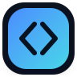
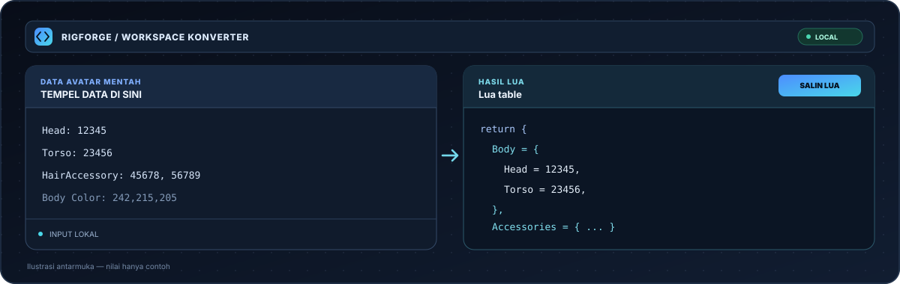
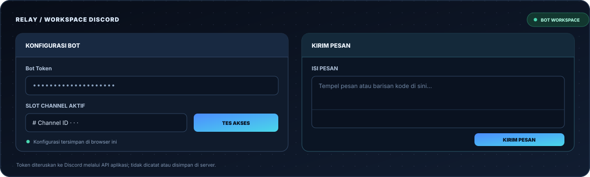
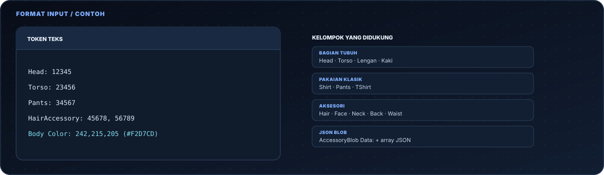
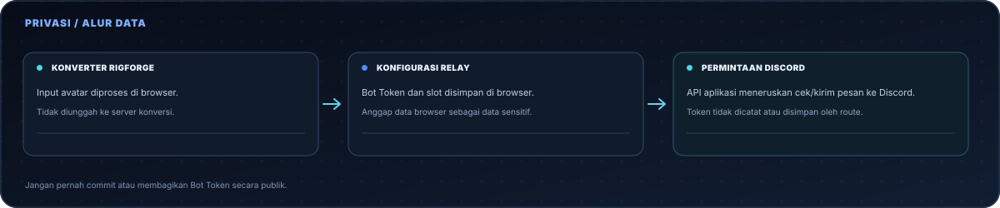

<div align="center">



# RigForge

<p>
  <a href="https://nextjs.org/"></a>
  <a href="https://react.dev/"></a>
  <a href="https://www.typescriptlang.org/"></a>
  <a href="https://vercel.com/"></a>
  <a href="https://vitest.dev/"></a>
  <a href="https://eslint.org/"></a>
  <a href="LICENSE"></a>
</p>

<p><a href="README.md">Bahasa Indonesia</a> · <a href="README.en.md">English</a></p>

<p><b>Konversi data avatar Roblox menjadi struktur Lua langsung di browser.</b> RigForge menyediakan panel konversi avatar, sementara Relay menjadi workspace terpisah untuk konfigurasi Discord Bot dan pengiriman pesan.</p>

<p>
  <a href="#coba-sekarang">Coba sekarang</a> ·
  <a href="#fitur">Fitur</a> ·
  <a href="#cara-pakai">Cara pakai</a> ·
  <a href="#format-input">Format input</a> ·
  <a href="#privasi">Privasi</a> ·
  <a href="#pengembangan">Pengembangan</a> ·
  <a href="#kontribusi">Kontribusi</a>
</p>

</div>

---

## Coba sekarang

Mulai konversi dalam tiga langkah:

1. Buka [RigForge](https://rigforge-mocha.vercel.app/).
2. Tempel token avatar atau data JSON pada panel input. Hasil Lua akan diperbarui otomatis.
3. Periksa hasilnya, tekan **Salin Kode**, lalu tempel dan uji di Roblox Studio.



Untuk mengirim pesan melalui Discord Bot API, buka [Relay](https://rigforge-mocha.vercel.app/relay), masukkan Bot Token resmi, pilih slot Channel ID, lalu uji akses sebelum mengirim.



## Fitur

**Konversi avatar**

- Konversi otomatis saat data input berubah, serta tombol **Generate Paksa** untuk menjalankan konversi segera.
- Mendukung token teks seperti `Head: 12345` dan JSON setelah penanda `AccessoryBlob Data:`.
- Mengelompokkan data ke bagian tubuh, pakaian klasik, layered clothing, dan aksesori.
- Menjaga jumlah slot minimum; slot kosong menggunakan `AssetId = 0`, sedangkan ID tambahan menambah baris.
- Menghapus ID duplikat dalam kelompok yang sama.
- Contoh data, reset input, dan penyalinan hasil Lua.

**Relay / Discord**

- Konfigurasi Bot Token resmi dan hingga 10 slot Channel ID.
- Label slot, pemilihan channel aktif, dan penyimpanan konfigurasi di browser.
- Pemeriksaan akses channel sebelum pengiriman.
- Mengirim pesan melalui Discord Bot API, dengan opsi format code block.
- Menangani rate limit `429` dengan jeda dan percobaan ulang terbatas.
- Status pengiriman dan riwayat singkat untuk sesi aktif.

**Antarmuka dan kualitas**

- Tema terang dan gelap.
- Layout responsif untuk desktop, tablet, dan perangkat mobile.
- Pemisahan parser, komponen UI, integrasi Discord, dan pengujian.
- Pemeriksaan TypeScript, ESLint, unit test Vitest, dan production build melalui GitHub Actions.

## Cara pakai

### 1. Tempel data avatar

RigForge menerima daftar token avatar maupun data JSON `AccessoryBlob`. Gunakan **Contoh Data** bila ingin mencoba tanpa menyiapkan data sendiri.



### 2. Periksa dan salin hasil Lua

Output dibuat otomatis. Gunakan **Generate Paksa** bila ingin menjalankan konversi saat itu juga, lalu tekan **Salin Kode** untuk menyalin seluruh hasil.


### 3. Siapkan Relay jika perlu mengirim pesan

1. Buka [Relay](https://rigforge-mocha.vercel.app/relay).
2. Tempel Bot Token dari [Discord Developer Portal](https://discord.com/developers/applications).
3. Isi dan simpan Channel ID pada slot yang diinginkan, lalu pilih slot aktif.
4. Jalankan pemeriksaan akses. Pastikan bot sudah masuk ke server dan punya izin yang sesuai.
5. Tulis pesan, tinjau channel tujuan, lalu kirim.


## Format input

Parser mencari token di seluruh teks dan tidak membedakan huruf besar/kecil.

```text
Head: 12345
Torso: 23456
Pants: 34567
HairAccessory: 45678, 56789
Body Color: 242,215,205 (#F2D7CD)
```

| Kelompok | Token atau format |
| -------- | ----------------- |
| Bagian tubuh | `Head`, `Torso`, `LeftArm`, `RightArm`, `LeftLeg`, `RightLeg` |
| Pakaian klasik | `Pants`, `Shirt`, `TShirt`; variasi `T-Shirt` dan `Tshirt` juga dikenali |
| Warna kulit | `Body Color` dengan RGB; nilai hex dalam tanda kurung diprioritaskan |
| Aksesori | `Hat`, `HairAccessory`, `FaceAccessory`, `FrontAccessory`, `NeckAccessory`, `BackAccessory`, `ShoulderAccessory`, `WaistAccessory` |
| Data JSON | Penanda `AccessoryBlob Data:` diikuti array JSON dengan properti `AccessoryType` dan `AssetId` |


### Aturan slot

Jumlah slot minimum dikonfigurasi melalui `LAYERED_GROUPS` dan `ACCESSORY_GROUPS` di `src/lib/converter.ts`.

| Kelompok | Slot minimum |
| -------- | ------------- |
| `Clothes.Layered` | `LeftShoe` 2, `RightShoe` 2, `TShirt` 3, `Shirt` 3, `Pants` 3, `Shorts` 3, `DressSkirt` 3, `Sweater` 3, `Jacket` 4 |
| `Accessories` | `Hat` 3, `Hair` 3, `Face` 7, `Front` 3, `Neck` 3, `Back` 3, `Shoulder` 3, `Waist` 3 |

Slot yang tidak terisi menggunakan `AssetId = 0`. ID tambahan menambah baris pada kelompok terkait, sementara ID duplikat dalam kelompok yang sama hanya ditulis sekali. Jenis aksesori yang belum dikenal mendapat kelompok baru. Detail lebih lanjut ada di [panduan format input](docs/INPUT_FORMAT.md).

## Privasi

- **Input avatar RigForge** diproses di browser dan tidak diunggah ke server konversi.
- **Konfigurasi Relay** seperti Bot Token dan slot channel disimpan di `localStorage` browser.
- Saat memeriksa akses atau mengirim pesan, Relay mengirim request ke API aplikasi, yang meneruskannya ke Discord. API route tidak menyimpan atau mencatat Bot Token.
- Gunakan Bot Token resmi dari Discord Developer Portal. Jangan gunakan token akun pribadi atau self-bot.
- Jangan bagikan atau commit token. Di perangkat bersama, hapus data situs setelah selesai.



## Pengembangan

### Menjalankan lokal

**Persyaratan:** Node.js 22.x, npm, dan Git.

```bash
git clone https://github.com/akndrn000/rigforge.git
cd rigforge
npm ci
npm run dev
```

Buka [http://localhost:3000](http://localhost:3000).

### Tes dan pemeriksaan kualitas

```bash
npm run typecheck
npm run lint
npm run test
npm run build
```

| Perintah | Kegunaan |
| -------- | -------- |
| `npm run dev` | Menjalankan server pengembangan Next.js |
| `npm run typecheck` | Memeriksa tipe TypeScript |
| `npm run lint` | Menjalankan ESLint |
| `npm run test` | Menjalankan unit test melalui Vitest |
| `npm run build` | Membuat build produksi |
| `npm run start` | Menjalankan build produksi secara lokal |

### Deploy ke Vercel

1. Impor repository `akndrn000/rigforge` melalui [Vercel](https://vercel.com/).
2. Pastikan framework terdeteksi sebagai Next.js dan gunakan Node.js 22.x.
3. Deploy. Halaman RigForge dan Relay tersedia pada deployment yang sama.

Deploy melalui CLI:

```bash
npx vercel --prod
```

### Tech stack

- **Next.js** dan **React** untuk aplikasi web.
- **TypeScript** untuk tipe dan validasi saat pengembangan.
- **CSS** untuk sistem desain dan tampilan responsif.
- **Discord Bot API** untuk pemeriksaan channel dan pengiriman pesan di Relay.
- **Vitest**, **ESLint**, dan **TypeScript** untuk pemeriksaan kualitas.
- **Vercel** untuk hosting aplikasi.

### Struktur folder

```text
src/
├── app/
│   ├── api/discord/
│   │   ├── check/route.ts   # Memeriksa Bot Token dan akses channel
│   │   └── send/route.ts    # Meneruskan pesan ke Discord
│   ├── relay/               # Halaman Relay
│   └── page.tsx             # Halaman utama
├── components/              # UI konverter, Relay, header, dan footer
├── hooks/                   # Tema dan konfigurasi Relay
├── lib/
│   ├── converter.ts         # Parser avatar dan generator Lua
│   ├── relay/               # Integrasi Discord dan tipe data
│   └── __fixtures__/        # Fixture pengujian konverter
└── styles/                  # Token dan stylesheet antarmuka

docs/
├── logo.svg                 # Logo untuk README
├── screenshots/             # Ilustrasi antarmuka dan panduan
└── INPUT_FORMAT.md          # Referensi format input
```

### Batasan yang diketahui

- RigForge tidak menyediakan tombol unduh file; output disalin melalui clipboard.
- Input konverter tidak disimpan sebagai riwayat setelah halaman dimuat ulang.
- Konfigurasi Relay tersimpan pada browser, sehingga tidak otomatis berpindah antarperangkat.
- Relay mengirim pesan nyata ke channel terpilih. Selalu periksa tujuan dan isi pesan sebelum mengirim.

## Kontribusi

Kontribusi dipersilakan.

1. Fork repository dan buat branch untuk perubahan.
2. Jalankan `npm ci`, lalu tambahkan atau perbarui tes jika logika berubah.
3. Pastikan pemeriksaan berikut berhasil:

   ```bash
   npm run typecheck
   npm run lint
   npm run test
   npm run build
   ```

4. Buka Pull Request dengan ringkasan perubahan dan alasan. Untuk laporan bug, sertakan langkah reproduksi dan contoh input yang aman—tanpa Bot Token atau data rahasia.

RigForge adalah proyek independen dan tidak berafiliasi dengan Roblox Corporation atau Discord Inc. Dirilis di bawah [MIT License](LICENSE).

---

<div align="center">
  <sub>RigForge — konversi avatar yang terstruktur, sederhana, dan berjalan di browser.</sub>
</div>
